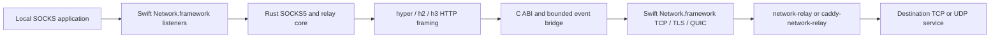

# Design goals and architecture

Revision: 0.1.0 development, 2026-10-11. This is the intended design; actual
implementation and evidence are tracked separately in [STATUS.md](STATUS.md).

## Goals

1. Provide a standalone application named Network Realy NF with the familiar
   Masque NF window, icon, server management, logs and menu bar.
2. Interoperate with the standard CONNECT and CONNECT-UDP endpoints of both
   network-relay and caddy-network-relay, without server modifications.
3. Use Apple Network.framework for every production OS network operation:
   relay DNS resolution, TCP/TLS, UDP/QUIC, QUIC streams and local SOCKS sockets.
4. Keep protocol logic and its portable tests separate from the Apple transport.
   Use real servers for protocol checks, and clearly identify tests that replace
   the native transport.
5. Preserve certificate verification, ALPN selection, cancellation, bounded
   queues and half-close behavior. Do not hide forced HTTP/3 failures as success.
6. Keep this application directory, documentation, configuration, build and lifecycle independent. Changes
   here must not change Masque NF or either relay server's production code.
7. Document defects and missing work accurately. Native QUIC repair has a limited
   time budget; HTTP/2 is the initial operational path when HTTP/3 is unreliable.

## Network ownership

`App/.../NativeClient.swift` owns NWListener, NWConnection and NWConnectionGroup.
`Core/src/native.rs` presents asynchronous byte streams and datagram sockets to
Rust using C ABI events. Production code contains no Rust socket dialing,
OS resolver, TLS handshake implementation or QUIC packet engine. Standard-library
IP/address types merely parse metadata; Tokio supplies scheduling and byte I/O.
Quinn and rustls are development dependencies used only by the test emulator.

Rust still implements HTTP/1.1, HTTP/2 and HTTP/3 framing, QPACK, SOCKS5 and
CONNECT-UDP Capsules. A network observer may distinguish HTTP settings, request
and control-stream ordering, timing and other application behavior. Using Apple's
TLS/QUIC transport does not guarantee an indistinguishable Apple application or
absence of Rust-influenced behavior. No fingerprint-evasion claim is made.

This client relays TCP and UDP directly. It does not allocate a virtual IP,
request CONNECT-IP routes, run smoltcp, create a TUN device, or send target DNS
queries through a client-side IP stack. SOCKS domain names go to the relay, which
resolves them under its own DNS and destination policy. A relay hostname is
resolved by Network.framework unless the user supplies its IP.

## Connections and readiness

The initial implementation opens one outer TLS/QUIC connection per destination
flow. It does not yet share one HTTP/2 or HTTP/3 connection across SOCKS flows.
This simplifies cancellation ownership but costs extra handshakes and server
connection slots; it is a documented limitation, not a finished performance design.

A separate authenticated idle CONNECT-UDP flow acts as the connection monitor.
“Relay ready” means that the server accepted this authenticated protocol request.
It does not prove arbitrary destination reachability, web access, working DNS or
continued liveness after a network change. The default probe target is
`1.1.1.1:53`; no application datagram is sent. Core configuration can override
`probe_target`. Server idle timeouts may close this flow and cause reconnects.
There is no application heartbeat yet. TCP-only policies that deny this probe
are not supported by the current readiness design.

Automatic mode tries HTTP/3 for five seconds, then native TCP with ALPN `h2`,
`http/1.1`. Authentication/security rejection is terminal rather than a reason
to downgrade. Forced modes do not silently change transport. The monitor's
successful transport becomes the preferred mode for new flows until reconnect.
Existing flows have separate outer connections and are not migrated.

## HTTP/3 scope

UDP uses RFC 9297 DATAGRAM Capsules on the request's reliable byte stream.
The client advertises no HTTP/3 DATAGRAM support and extracts no native DATAGRAM
child. This is permitted by the protocol and both server implementations support
Capsules. It avoids the earlier clients' extra DATAGRAM extraction and its known
lifecycle concerns. It can cause head-of-line blocking; native unreliable QUIC
DATAGRAM optimization is deliberately deferred.

The inherited NWConnectionGroup stream adapter remains experimental. The initial
core also disables outbound GREASE streams to keep the layout simple during
bring-up. These two changes are design choices, not a controlled proof of the
old fault's cause or a claim that native HTTP/3 is repaired. Actual stream IDs
are logged and range-checked. Complete local stream direction/initiator checks
and modern NetworkConnection<QUIC> evaluation are deferred.

## Isolation and UI

Bundle identifier: `com.arccal.network-realy-nf`. Executable/module:
`NetworkRealyNF`. The app has its own Application Support directory and does not
import an existing Masque NF store automatically. Password persistence follows
the copied file-store design; Keychain migration is not implemented.

The copied UI includes server CRUD, active selection, transport changes,
application/proxy settings, scoped TOML import/export, masked passwords, in-memory
logs, menu controls, connect on launch and deletion of this app's stored settings.
The active-server restart and blank-new-server selection fixes are retained.
The user has reported a Mac build/launch and SOCKS TCP/UDP forwarding success.
The individual UI behaviors and complete native acceptance matrix still need
verification; [the evidence](evidence/native-mac-20261011.md) records the limits.
